# Java Backend Class Diagram - Health Connect System

```mermaid
classDiagram
    %% Controllers
    class UserController {
        -UserService userService
        +UserController(UserService)
        +getAllUsers(int, int) ResponseEntity
        +getUserById(Long) ResponseEntity
        +updateUser(Long, Map) ResponseEntity
        +deleteUser(Long) ResponseEntity
    }

    class AuthController {
        -AuthenticationManager authenticationManager
        -UserDetailsService userDetailsService
        -JwtUtil jwtUtil
        -UserService userService
        -SessionService sessionService
        +login(Map) ResponseEntity
        +register(Map) ResponseEntity
        +refresh(Authentication) ResponseEntity
        +validateSession(String) ResponseEntity
    }

    class HealthMetricController {
        -HealthMetricService healthMetricService
        +logMetric(Map) ResponseEntity
        +getUserMetrics(Long) ResponseEntity
        +getDailyTrends(Long, LocalDate, LocalDate) ResponseEntity
        +getWeeklyTrends(Long, LocalDate, LocalDate) ResponseEntity
    }

    class AppointmentController {
        -AppointmentService appointmentService
        -UserService userService
        +getAllDoctors(Authentication) ResponseEntity
        +scheduleAppointment(Map, Authentication) ResponseEntity
        +cancelAppointment(Long, Authentication) ResponseEntity
        +updateStatus(Long, Map, Authentication) ResponseEntity
    }

    class MessageController {
        -MessageService messageService
        -UserService userService
        -SupportTicketService ticketService
        +sendMessage(Map, Authentication) ResponseEntity
        +sendTicketMessage(Long, Map, Authentication) ResponseEntity
        +getInbox(Long) ResponseEntity
    }

    class DietPlanRequestController {
        -DietPlanRequestService requestService
        -UserService userService
        +createRequest(Map, Authentication) ResponseEntity
        +acceptRequest(Long, Authentication) ResponseEntity
        +getPendingRequests(Authentication) ResponseEntity
    }

    class SupportTicketController {
        -SupportTicketService ticketService
        -UserService userService
        +createTicket(Map, Authentication) ResponseEntity
        +acceptTicket(Long, Authentication) ResponseEntity
        +getOpenTickets(Authentication) ResponseEntity
    }

    class ComplianceController {
        -AccessLogService accessLogService
        -UserService userService
        +getAccessLogs(LocalDateTime, LocalDateTime, Authentication) ResponseEntity
        +exportLogsToCSV(LocalDateTime, LocalDateTime, Authentication) ResponseEntity
    }

    %% Services
    class UserService {
        -UserRepository userRepository
        -HtmlSanitizer htmlSanitizer
        -PasswordEncoder passwordEncoder
        +findByEmail(String) Optional
        +createUser(String, String, String, Role) User
        +updateUser(Long, String, String) User
        +getAllUsers() List
    }

    class SessionService {
        -UserSessionRepository sessionRepository
        +createOrUpdateSession(Long, String) void
        +updateActivity(String) void
        +isSessionValid(String) boolean
    }

    class HealthMetricService {
        -HealthMetricRepository healthMetricRepository
        -HealthScoreCalculator healthScoreCalculator
        -HtmlSanitizer htmlSanitizer
        +logMetric(...) HealthMetric
        +getUserMetrics(Long) List
        +getDailyTrends(Long, LocalDate, LocalDate) List
    }

    class AppointmentService {
        -AppointmentRepository appointmentRepository
        -HtmlSanitizer htmlSanitizer
        +scheduleAppointment(...) Appointment
        +cancelAppointment(Long, Long) void
        +hasConflict(Long, LocalDateTime) boolean
    }

    class MessageService {
        -MessageRepository messageRepository
        -HtmlSanitizer htmlSanitizer
        +sendMessage(Long, Long, String) Message
        +getInbox(Long) List
    }

    class DietPlanRequestService {
        -DietPlanRequestRepository requestRepository
        -HtmlSanitizer htmlSanitizer
        +createRequest(...) DietPlanRequest
        +acceptRequest(Long, Long) DietPlanRequest
        +getPendingRequests() List
    }

    class SupportTicketService {
        -SupportTicketRepository ticketRepository
        -HtmlSanitizer htmlSanitizer
        +createTicket(Long, String, String) SupportTicket
        +acceptTicket(Long, Long) SupportTicket
    }

    class AccessLogService {
        -AccessLogRepository accessLogRepository
        +logAccess(Long, String, String, String) void
        +getAllLogs() List
    }

    %% Repositories
    class UserRepository {
        <<interface>>
        +findByEmail(String) Optional
        +findByRole(Role) List
    }

    class UserSessionRepository {
        <<interface>>
        +findByUserId(Long) Optional
        +findByToken(String) Optional
    }

    class HealthMetricRepository {
        <<interface>>
        +findByUserIdOrderByDateDesc(Long) List
        +findByUserIdAndDateBetween(Long, LocalDate, LocalDate) List
    }

    class AppointmentRepository {
        <<interface>>
        +findByPatientIdOrderByScheduledTimeDesc(Long) List
        +findByClinicianIdAndScheduledTimeBetween(Long, LocalDateTime, LocalDateTime) List
    }

    class MessageRepository {
        <<interface>>
        +findByRecipientIdOrderByTimestampDesc(Long) List
    }

    class DietPlanRequestRepository {
        <<interface>>
        +findByStatus(RequestStatus) List
        +countByPatientIdAndStatus(Long, RequestStatus) int
    }

    class SupportTicketRepository {
        <<interface>>
        +findByStatus(TicketStatus) List
    }

    class AccessLogRepository {
        <<interface>>
        +findByUserIdOrderByTimestampDesc(Long) List
    }

    %% Entities
    class User {
        -Long id
        -String name
        -String email
        -String passwordHash
        -Role role
        -LocalDateTime createdAt
        +getId() Long
        +getName() String
        +getRole() Role
    }

    class UserSession {
        -Long id
        -Long userId
        -String token
        -LocalDateTime lastActivity
        +getId() Long
        +getToken() String
    }

    class Appointment {
        -Long id
        -Long patientId
        -Long clinicianId
        -LocalDateTime scheduledTime
        -AppointmentStatus status
        +getId() Long
        +getStatus() AppointmentStatus
    }

    class HealthMetric {
        -Long id
        -Long userId
        -LocalDate date
        -Integer caloriesIntake
        -Integer healthScore
        +getId() Long
        +getHealthScore() Integer
    }

    class Message {
        -Long id
        -Long senderId
        -Long recipientId
        -String content
        -boolean isRead
        +getId() Long
        +isRead() boolean
    }

    class DietPlanRequest {
        -Long id
        -Long patientId
        -RequestStatus status
        -Long assignedDieticianId
        +getId() Long
        +getStatus() RequestStatus
    }

    class SupportTicket {
        -Long id
        -Long patientId
        -TicketStatus status
        -Long assignedStaffId
        +getId() Long
        +getStatus() TicketStatus
    }

    class AccessLog {
        -Long id
        -Long userId
        -String action
        -LocalDateTime timestamp
        +getId() Long
        +getAction() String
    }

    %% Enums
    class Role {
        <<enumeration>>
        PATIENT
        DIETITIAN
        PHYSICIAN
        SUPPORT_STAFF
        SYSTEM_ADMIN
        SUPER_ADMIN
    }

    class AppointmentStatus {
        <<enumeration>>
        SCHEDULED
        COMPLETED
        CANCELLED
    }

    class RequestStatus {
        <<enumeration>>
        PENDING
        ACCEPTED
        COMPLETED
    }

    class TicketStatus {
        <<enumeration>>
        OPEN
        ASSIGNED
        RESOLVED
    }

    %% DTOs
    class UserDTO {
        -Long id
        -String name
        -String email
        +fromEntity(User) UserDTO
    }

    class HealthMetricDTO {
        -Long id
        -Integer healthScore
        +fromEntity(HealthMetric) HealthMetricDTO
    }

    class HealthTrendDTO {
        -LocalDate date
        -Double avgHealthScore
        +getDate() LocalDate
    }

    %% Config
    class SecurityConfig {
        -JwtAuthenticationFilter jwtAuthenticationFilter
        +securityFilterChain(HttpSecurity) SecurityFilterChain
        +passwordEncoder() PasswordEncoder
    }

    class WebConfig {
        -AccessLogInterceptor accessLogInterceptor
        +addInterceptors(InterceptorRegistry) void
    }

    class AccessLogInterceptor {
        -AccessLogService accessLogService
        -UserService userService
        +preHandle(HttpServletRequest, HttpServletResponse, Object) boolean
    }

    %% Security
    class JwtAuthenticationFilter {
        -JwtUtil jwtUtil
        -SecurityUtil securityUtil
        -SessionService sessionService
        +doFilterInternal(HttpServletRequest, HttpServletResponse, FilterChain) void
    }

    class JwtUtil {
        -String secret
        -long expirationMs
        +generateToken(UserDetails) String
        +validateToken(String, UserDetails) boolean
    }

    class SecurityUtil {
        +extractToken(HttpServletRequest) String
    }

    %% Utilities
    class HtmlSanitizer {
        -PolicyFactory policy
        +sanitize(String) String
    }

    class SqlEscapeUtil {
        <<final>>
        +escapeSql(String) String
    }

    class HealthScoreCalculator {
        +predictScore(List) int
    }

    %% Relationships - Controllers to Services
    UserController --> UserService
    AuthController --> UserService
    AuthController --> SessionService
    AuthController --> JwtUtil
    HealthMetricController --> HealthMetricService
    AppointmentController --> AppointmentService
    AppointmentController --> UserService
    MessageController --> MessageService
    MessageController --> UserService
    MessageController --> SupportTicketService
    DietPlanRequestController --> DietPlanRequestService
    DietPlanRequestController --> UserService
    SupportTicketController --> SupportTicketService
    SupportTicketController --> UserService
    ComplianceController --> AccessLogService
    ComplianceController --> UserService

    %% Services to Repositories
    UserService --> UserRepository
    SessionService --> UserSessionRepository
    HealthMetricService --> HealthMetricRepository
    AppointmentService --> AppointmentRepository
    MessageService --> MessageRepository
    DietPlanRequestService --> DietPlanRequestRepository
    SupportTicketService --> SupportTicketRepository
    AccessLogService --> AccessLogRepository

    %% Services to Utilities
    UserService --> HtmlSanitizer
    UserService ..> SqlEscapeUtil
    HealthMetricService --> HtmlSanitizer
    HealthMetricService --> HealthScoreCalculator
    AppointmentService --> HtmlSanitizer
    MessageService --> HtmlSanitizer
    DietPlanRequestService --> HtmlSanitizer
    SupportTicketService --> HtmlSanitizer

    %% Repositories to Entities
    UserRepository --|> JpaRepository
    UserRepository ..> User
    UserSessionRepository --|> JpaRepository
    UserSessionRepository ..> UserSession
    HealthMetricRepository --|> JpaRepository
    HealthMetricRepository ..> HealthMetric
    AppointmentRepository --|> JpaRepository
    AppointmentRepository ..> Appointment
    MessageRepository --|> JpaRepository
    MessageRepository ..> Message
    DietPlanRequestRepository --|> JpaRepository
    DietPlanRequestRepository ..> DietPlanRequest
    SupportTicketRepository --|> JpaRepository
    SupportTicketRepository ..> SupportTicket
    AccessLogRepository --|> JpaRepository
    AccessLogRepository ..> AccessLog

    %% Services to Entities
    SessionService ..> UserSession
    AccessLogService ..> AccessLog

    %% DTOs to Entities
    UserDTO ..> User
    HealthMetricDTO ..> HealthMetric
    HealthTrendDTO ..> HealthMetric

    %% Entities to Enums
    User *-- Role
    Appointment *-- AppointmentStatus
    DietPlanRequest *-- RequestStatus
    SupportTicket *-- TicketStatus

    %% Security Configuration
    SecurityConfig --> JwtAuthenticationFilter
    JwtAuthenticationFilter --> JwtUtil
    JwtAuthenticationFilter --> SecurityUtil
    JwtAuthenticationFilter --> SessionService

    %% Config
    WebConfig --> AccessLogInterceptor
    AccessLogInterceptor --> AccessLogService
    AccessLogInterceptor --> UserService
```



## Notes

### Code Examples

**1. Static Helper vs Injectable Bean**

```java
// Static Utility (SqlEscapeUtil) - Cannot be mocked
public final class SqlEscapeUtil {
    private SqlEscapeUtil() {}
    
    public static String escapeSql(String s) {
        return s.replace("'", "''");
    }
}

// Injectable Bean (HtmlSanitizer) - Can be mocked in tests
@Component
public class HtmlSanitizer {
    private final PolicyFactory policy = Sanitizers.FORMATTING.and(Sanitizers.LINKS);
    
    public String sanitize(String input) {
        return policy.sanitize(input);
    }
}
```

**2. Constructor Injection Pattern**

```java
@Service
public class UserService {
    private final UserRepository userRepository;
    private final HtmlSanitizer htmlSanitizer;
    private final PasswordEncoder passwordEncoder;
    
    public UserService(UserRepository userRepository, 
                      HtmlSanitizer htmlSanitizer,
                      PasswordEncoder passwordEncoder) {
        this.userRepository = userRepository;
        this.htmlSanitizer = htmlSanitizer;
        this.passwordEncoder = passwordEncoder;
    }
}
```

### Watch-Out Tips

1. **Never mix field injection with constructor injection**
   - ❌ Wrong: Using `@Autowired` on fields alongside constructor parameters
   - ✅ Correct: Always use `private final` fields with constructor injection only

2. **Avoid circular dependencies between services**
   - ❌ Wrong: ServiceA depends on ServiceB, and ServiceB depends on ServiceA
   - ✅ Correct: Extract common logic to a separate service or use events

3. **Don't mix static utilities with beans when you need to mock behavior**
   - ❌ Wrong: Using static methods in production code that needs testing with mocks
   - ✅ Correct: Use `@Component` beans for logic that requires mocking in tests

### Architecture Summary

- **9 Controllers** - REST endpoints with role-based access
- **9 Services** - Business logic with constructor injection
- **8 Repositories** - JPA data access interfaces
- **8 Entities** - Database models with JPA annotations
- **4 Enums** - Type-safe constants
- **3 DTOs** - Data transfer objects
- **3 Config** - Security and interceptor configuration
- **3 Security** - JWT authentication and filtering
- **3 Utilities** - Reusable helper components

**Total: 50 classes/interfaces** representing the complete Health Connect backend system.
